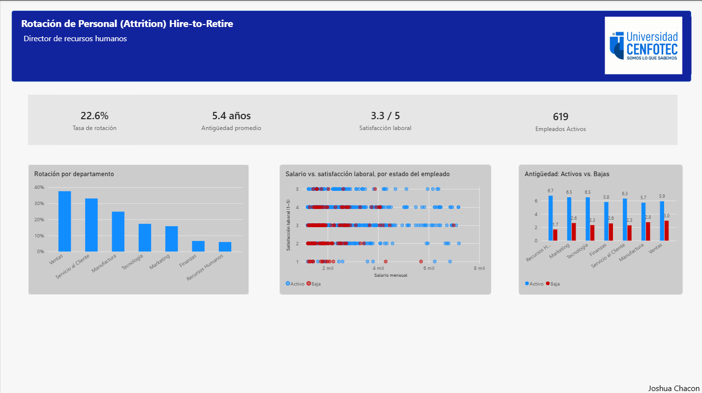
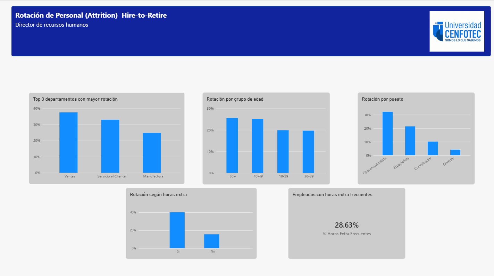

# Hire-to-Retire: Human Capital Analytics Dashboard

🇪🇸 [Leer en español](README.md)

Final project for the **Business Analytics I** course at CENFOTEC University.

> ⚠️ **Disclaimer:** the data used in this project is **fictitious**. It was provided by the course for academic purposes and does not correspond to real employees or a real company.

## Files

- 📊 [Download Power BI file (.pbix)](Proyecto-final-Business-Analytics-I.pbix?raw=true)

## Context

The **Hire-to-Retire** case of a mid-sized company (manufacturing and technology) whose employee turnover has increased in recent quarters. The Human Resources Director needs to explain to General Management who is leaving, from which areas, and which factors are associated with departures, in order to decide where to focus retention actions.

## About the data

The dataset is **synthetic (fictitious)** and was provided by the Business Analytics I course for educational purposes. It contains 800 employees with a cutoff date of December 31, 2024. Any resemblance to a real organization or person is coincidental, and the conclusions of this project should not be interpreted as a diagnosis of any real company.

## Key KPIs

| Indicator | Value |
| --- | --- |
| Turnover rate | 22.6% |
| Average tenure | 5.4 years |
| Job satisfaction | 3.3 / 5 |
| Active employees | 619 |
| Employees with frequent overtime | 28.6% |

## Key findings

1. **Turnover is high and concentrated.** The overall rate is 22.6%, but Sales (~38%) and Customer Service (~33%) are far above the rest, while Finance and Human Resources are below 10%.
2. **Those who leave do so early.** Departures had an average tenure of 2 to 3 years, compared with about 6 years for those who stay.
3. **Departures concentrate at low satisfaction.** Employees who left are grouped in satisfaction levels 1 to 3.
4. **Frequent overtime increases turnover.** Those who work it (28.6% of the workforce) leave noticeably more than those who do not.
5. **Turnover drops as seniority level rises.** Operators/Analysts (~32%) and Specialists (~22%) account for most departures, while in Management it is ~4%.
6. **Age matters little.** Turnover is similar across age groups (20% to 25%).

## Conclusion

Turnover is concentrated in **Sales and Customer Service**, in **operational roles**, and among **employees with short tenure, low satisfaction and frequent overtime**. Workload appears as a key factor, ahead of age.

## Recommendations

- Prioritize Sales and Customer Service.
- Review workload and reduce frequent overtime in critical areas.
- Strengthen onboarding and follow-up during the first 3 years, especially in operational roles.
- Measure satisfaction on a recurring basis to act before departures happen.

## Tools

Power BI Desktop · DAX · Power Query
