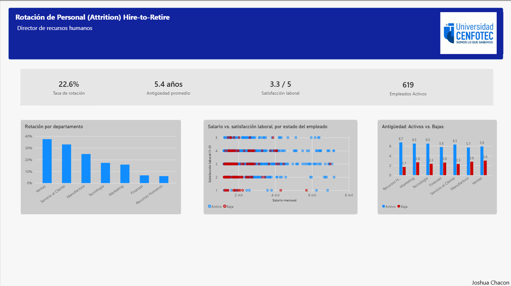
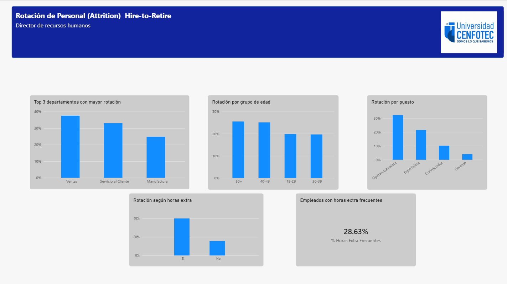

# Hire-to-Retire: Dashboard de Analítica de Capital Humano

Proyecto final del curso **Business Analytics I** de la Universidad CENFOTEC.

> ⚠️ **Aviso:** los datos utilizados en este proyecto son **ficticios**. Fueron proporcionados por la universidad con fines académicos y no corresponden a empleados ni a una empresa real.

## Archivos
- 📊 [Descargar archivo Power BI (.pbix)](Proyecto-final-Business-Analytics-I.pbix)
- 📁 [Descargar Caso2_HireToRetire.xlsx](./data/Caso2_HireToRetire.xlsx?raw=true)

## Contexto
Caso **Hire-to-Retire** de una empresa mediana (manufactura y tecnología) que ha visto aumentar su rotación de personal en los últimos trimestres. El Director de Recursos Humanos necesita explicar a la Gerencia General quién se está yendo, desde qué áreas y qué factores se asocian a la salida, para decidir dónde enfocar acciones de retención.

## Sobre los datos
El dataset es **sintético (ficticio)** y fue entregado por el curso Business Analytics I con fines educativos. Contiene 800 empleados con corte al 31 de diciembre de 2024. Cualquier parecido con una organización o persona real es coincidencia, y las conclusiones de este proyecto no deben interpretarse como un diagnóstico de ninguna empresa real.

## KPIs principales
| Indicador | Valor |
|---|---|
| Tasa de rotación | 22.6% |
| Antigüedad promedio | 5.4 años |
| Satisfacción laboral | 3.3 / 5 |
| Empleados activos | 619 |
| Empleados con horas extra frecuentes | 28.6% |

## Hallazgos principales
1. **La rotación es alta y está concentrada.** La tasa global es de 22.6%, pero Ventas (~38%) y Servicio al Cliente (~33%) superan ampliamente al resto, mientras que Finanzas y Recursos Humanos están por debajo del 10%.
2. **Quienes se van lo hacen temprano.** Las bajas tenían en promedio entre 2 y 3 años de antigüedad, frente a cerca de 6 años de quienes permanecen.
3. **Las bajas se concentran en satisfacción baja.** Los empleados que salieron se agrupan en niveles de satisfacción de 1 a 3.
4. **Las horas extra frecuentes elevan la rotación.** Quienes las tienen (28.6% de la plantilla) rotan notablemente más que quienes no.
5. **La rotación baja al subir de nivel.** Operarios/Analistas (~32%) y Especialistas (~22%) concentran las salidas, mientras que en Gerencia es de ~4%.
6. **La edad pesa poco.** La rotación es similar entre grupos de edad (20% a 25%).

## Conclusión
La rotación se concentra en **Ventas y Servicio al Cliente**, en **puestos operativos** y en **empleados con poca antigüedad, baja satisfacción y horas extra frecuentes**. La carga laboral aparece como un factor clave, por encima de la edad.

## Recomendaciones
- Priorizar Ventas y Servicio al Cliente
- Revisar la carga laboral y reducir las horas extra frecuentes en las áreas críticas.
- Reforzar el onboarding y el seguimiento en los primeros 3 años, sobre todo en puestos operativos.
- Medir la satisfacción de forma recurrente para actuar antes de las bajas.

## Herramientas
Power BI Desktop · DAX · Power Query
